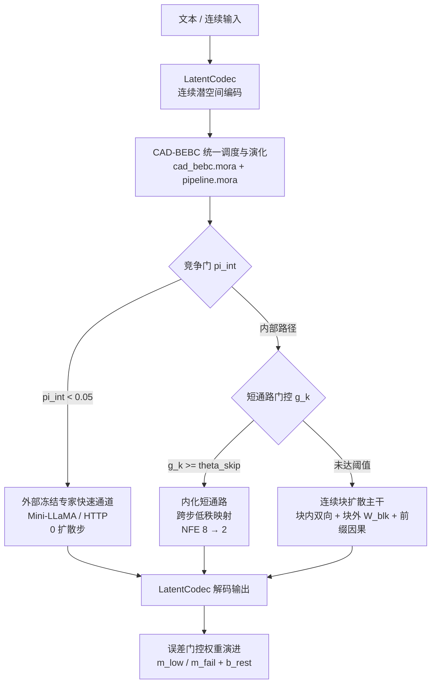

# mora-llm-diffusion (CAD-BEBC)

基于 **Mora v0.111.0** 语言工具链实现的 **CAD-BEBC（连续自回归扩散块外双向因果架构）** 统一系统：以连续潜空间块扩散为主干，整合**块内双向 + 块外可微双向因果 $W_{blk}$ + 前缀因果顺序**，融合反向传播梯度与死区软门（`m_low / m_fail` + 静息偏置 `b_rest`），由权重自身缓慢演进自然涌现跨步低秩短通路、跳过门神经元及 OOD 高误差回退能力，并与外部冻结专家（Mini-LLaMA / HTTP 服务）无路由器协同。

## 统一系统架构



## 真实数据集训练（TinyStories）

使用 TinyStories 样本（`data/tinystories_sample.txt`，~2MB）进行主干预训练：

```bash
# 修改 src/train.mora 中的配置路径为 config/train_tinystories.json，或直接运行
mora src/train.mora
```

配置见 `config/train_tinystories.json`（d_model=128，4 层，seq_len=64，2000 步）。

训练完成后可推到 Hugging Face：

```bash
python scripts/prepare_hf.py
huggingface-cli upload Microbiosis/cad-bebc-tinystories hf_model .
```

## 目录结构

```text
.
├── archive/
│   └── trainable_llm.mora          # 早期单文件微型原型（历史归档）
├── config/
│   ├── default.json                # 外部 Mini-LLaMA 预训练与分词器配置
│   ├── diffusion.json              # CAD-BEBC 默认配置（2 层 D=32、prefix_blocks=2、mode=llama）
│   ├── diffusion.industrial.json   # CAD-BEBC 工业级目标配置（d=256、8 层、16 块）
│   └── train_tinystories.json      # TinyStories 真实数据集训练配置
├── data/
│   ├── corpus.txt                  # 微型玩具语料
│   └── tinystories_sample.txt      # TinyStories 样本（~2MB）
├── docs/
│   └── cad_bebc_architecture.md    # CAD-BEBC 统一架构规范与边界说明
├── models/
│   ├── mini_llama_frozen.safetensors  # 冻结的 Mini-LLaMA 外部专家与潜空间编解码权重（25,056 参数）
│   └── external_expert.safetensors    # 备用离线冻结 SwiGLU 外部专家权重（14,400 参数）
├── checkpoints/                    # 训练输出目录（按 .gitignore 忽略权重缓存）
├── scripts/
│   └── prepare_hf.py               # 生成 HF 模型卡并提供上传命令
├── src/
│   ├── cad_bebc.mora               # 【统一主入口】CAD-BEBC 全流程演化、文本/潜空间统一推理与 OOD 适应
│   ├── latent_codec.mora           # 离散文本 <-> 连续潜空间块编解码器
│   ├── diffusion/
│   │   ├── config.mora             # CAD-BEBC 超参数与外部专家配置加载
│   │   ├── backbone.mora           # 连续块扩散主干（Pre-RMSNorm + 结构偏置注意力 + SwiGLU）
│   │   ├── causal_graph.mora       # 块内双向 + 前缀因果掩码 + 误差门控反传块间因果权重 W_blk
│   │   ├── shortcut.mora           # 死区软门 m_low/m_fail、跨步低秩短通路与门控神经元 (w_g, b_g)
│   │   ├── expert.mora             # 外部冻结专家统一适配器（支持 llama / http / safetensors）
│   │   ├── external_service.mora   # 基于 std/net/http 的独立外部模型 HTTP 服务 (/v1/predict, /health)
│   │   ├── prepare_external_expert.mora  # 离线生成备用 SafeTensors 专家权重工具
│   │   └── pipeline.mora           # 统一可微损失与死区慢可塑性 (emerge_step)、真跳步推理与文本管线
│   ├── config.mora                 # Mini-LLaMA 配置加载（供外部专家预训练与 LatentCodec 共用）
│   ├── tokenizer.mora              # 纯 Mora UTF-8 字节级分词器（Vocab = 101）
│   ├── data.mora                   # 语料切分、多批次采样、因果掩码与 RoPE 表
│   ├── model.mora                  # Mini-LLaMA 模型定义（RoPE + GQA + SwiGLU + 潜空间隐状态接口）
│   ├── optim.mora                  # Cosine Warmup 调度与 AdamW
│   ├── checkpoint.mora             # std/nn/safetensors 磁盘权重读写
│   ├── sampler.mora                # Top-K / Temperature 采样解码
│   ├── train.mora                  # 外部 Mini-LLaMA 专家离线预训练脚本
│   └── generate.mora               # 外部 Mini-LLaMA 独立对比基线生成脚本
└── tests/
    ├── tokenizer_test.mora         # 分词器单元测试
    ├── model_test.mora             # RoPE/GQA/因果掩码/有限差分梯度单元测试
    ├── checkpoint_test.mora        # SafeTensors 磁盘一致性测试
    └── diffusion_test.mora         # CAD-BEBC 三层注意力、实时 HTTP 外部服务、统一文本管线与梯度涌现测试
```

## 常用命令

请在项目根目录运行：

```bash
# 1. 运行 CAD-BEBC 统一系统主入口（潜空间编码 -> 冻结 Mini-LLaMA 快路径 -> 梯度涌现 -> 短通路推理 -> 文本解码）
mora src/cad_bebc.mora

# 2. 静态类型检查与代码格式校验
mora --check src/cad_bebc.mora
mora fmt --check src tests

# 3. 运行全量并发单元测试套件
mora test

# 4. 可选：启动独立外部 HTTP 模型服务（供 external_expert.mode="http" 对接）
mora src/diffusion/external_service.mora

# 5. 可选：重新训练外部 Mini-LLaMA 专家权重
mora src/train.mora
```
